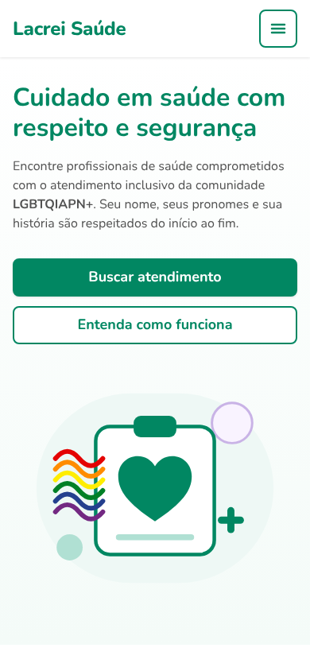

# Lacrei Saúde · Desafio Técnico Front-end

Duas páginas interativas, acessíveis e responsivas que seguem a identidade visual da Lacrei Saúde (Marsha Design System), construídas com **Next.js 16 + TypeScript + Styled-Components**.

- **Deploy:** https://lacrei-desafio-mu.vercel.app
- **Repositório:** https://github.com/ffabricioffs/lacrei-desafio

| Página | Rota | O que faz |
| --- | --- | --- |
| Início | `/` | Apresentação, "como funciona", público-alvo e perguntas frequentes (acordeão) |
| Buscar profissionais | `/profissionais` | Busca com filtros consumindo uma **API simulada** (`/api/profissionais`) |
| 404 | qualquer outra | Página de erro com caminho de volta ao início |

<p>
  
  
</p>

---

## Sumário

1. [Como rodar localmente](#como-rodar-localmente)
2. [Scripts](#scripts)
3. [Estrutura do projeto](#estrutura-do-projeto)
4. [Fluxo navegável e botões interativos](#fluxo-navegável-e-botões-interativos)
5. [Acessibilidade](#acessibilidade)
6. [Performance](#performance)
7. [Testes (registro)](#testes-registro)
8. [Mock de integração com API](#mock-de-integração-com-api)
9. [Build e deploy (Vercel)](#build-e-deploy-vercel)
10. [Rollback](#rollback)
11. [Justificativas visuais e técnicas](#justificativas-visuais-e-técnicas)
12. [Checklist dos critérios de aceite](#checklist-dos-critérios-de-aceite)

---

## Como rodar localmente

**Pré-requisitos:** Node.js 20.9 ou superior (recomendado: 22 LTS) e npm.

```bash
git clone https://github.com/ffabricioffs/lacrei-desafio.git
cd lacrei-desafio
npm install
npm run dev
```

Acesse <http://localhost:3000>. Não há variáveis de ambiente obrigatórias.

## Scripts

| Comando | Descrição |
| --- | --- |
| `npm run dev` | Servidor de desenvolvimento |
| `npm run build` | Build de produção |
| `npm start` | Sobe o build de produção (porta 3000) |
| `npm run lint` | ESLint (regras `next/core-web-vitals` + TypeScript) |
| `npm run typecheck` | Checagem de tipos com `tsc` |
| `npm test` | Testes unitários (Jest + Testing Library + jest-axe) |
| `npm run test:coverage` | Testes com relatório de cobertura em `coverage/` |
| `npm run ci` | Lint, tipos, testes e build em sequência (o mesmo que o CI roda) |
| `npm run lighthouse` | Lighthouse na URL local (com `npm start` rodando em outro terminal) |

## Estrutura do projeto

```
src/
├── app/
│   ├── layout.tsx              # HTML base (lang pt-BR), fonte, Header, <main>, Footer
│   ├── page.tsx                # Página inicial
│   ├── profissionais/page.tsx  # Página de busca
│   ├── api/profissionais/      # Route Handler: API simulada
│   ├── not-found.tsx           # 404
│   └── fonts/                  # Nunito auto-hospedada (.woff2)
├── components/
│   ├── Button/                 # Button e ButtonLink (+ testes)
│   ├── Header/                 # Header com menu mobile acessível (+ testes)
│   ├── Footer/                 # Footer com aviso de emergência e CVV (+ testes)
│   ├── Accordion/              # Acordeão WAI-ARIA (+ testes)
│   ├── ProfessionalSearch/     # Busca com filtros e estados (+ testes)
│   ├── ProfessionalCard/       # Card com detalhes expansíveis
│   ├── Home/                   # Seções da página inicial
│   └── ui/                     # Container, VisuallyHidden, SkipLink…
├── data/profissionais.json     # Dados fictícios
├── lib/                        # Registry do styled-components e lógica de filtro
├── services/professionals.ts   # Cliente HTTP da API
├── styles/                     # Tema (tokens Marsha) e estilos globais
└── types/
```

## Fluxo navegável e botões interativos

1. **Início → Busca:** "Buscar atendimento" (hero e header) e "Encontrar profissionais" levam a `/profissionais` via `next/link` (navegação client-side com prefetch).
2. **Âncora:** "Entenda como funciona" rola até a seção `#como-funciona`, com rolagem suave apenas se a pessoa não pediu menos movimento (`prefers-reduced-motion`).
3. **Busca → Início:** breadcrumb, logo e links do header/footer.

Botões com **ação real**:

| Botão | Ação |
| --- | --- |
| Menu (mobile) | Abre/fecha a navegação (`aria-expanded`, `aria-controls`, Esc fecha e devolve o foco) |
| Buscar | Envia o formulário e consulta a API |
| Online / Presencial / Todas | Filtra os resultados na hora (rádios nativos com visual de chip) |
| Limpar filtros | Restaura a busca e devolve o foco ao campo de texto |
| Ver detalhes | Expande bio e recursos de acessibilidade do profissional |
| Tentar novamente | Refaz a requisição após um erro |
| Perguntas frequentes | Acordeão que abre/fecha cada resposta |

## Acessibilidade

**Resultado no Lighthouse: 100/100 nas duas páginas** (mobile e desktop). O mínimo exigido é 90.

O que foi aplicado:

- **HTML semântico:** `header`, `nav` (com rótulos distintos), `main`, `section` com `aria-labelledby`, `article` para cada profissional, `footer`, listas reais (`ul`/`ol`), um único `h1` por página e hierarquia de títulos sem saltos.
- **Teclado:** link "Pular para o conteúdo principal" como primeiro item focável; foco sempre visível (contorno de 3px); ordem de tabulação seguindo a ordem visual; Esc fecha o menu.
- **ARIA só onde o HTML não basta:** `aria-expanded`/`aria-controls` (menu, acordeão, detalhes do card), `aria-current="page"` (link ativo), `role="status"` + `aria-live="polite"` (total de resultados), `role="alert"` (erro), `role="search"` (formulário de busca).
- **Leitores de tela:** links externos avisam "(abre em nova aba)"; botões "Ver detalhes" incluem o nome da pessoa em texto oculto ("Ver detalhes de Dra. Helena Duarte"); ilustrações decorativas com `alt=""`.
- **Formulário:** `label` associado a cada campo, dica ligada por `aria-describedby`, rádios nativos agrupados em `fieldset`/`legend`.
- **Contraste (WCAG AA):** verde `#018762` sobre branco = 4,52:1; títulos `#131313` = 18,6:1; corpo `#2D2D2D` = 13,8:1; texto de apoio `#515151` = 7,9:1; anel de foco `#28588A` = 7,4:1.
- **Alvos de toque:** botões com no mínimo 44–48px de altura.
- **Movimento reduzido:** animações e rolagem suave desligadas com `prefers-reduced-motion: reduce`.
- **Testes automatizados com `jest-axe`** em todos os componentes testados (zero violações).

### Teste com leitor de tela

Teste manual feito em **20/11/2026** com **NVDA + Microsoft Edge (Windows 11)** no deploy de produção, acompanhando o Visualizador de fala do NVDA.

| Verificação | O que o NVDA anunciou | Resultado |
| --- | --- | --- |
| Link de pular conteúdo | "mesma página, link, Pular para o conteúdo principal" como primeiro item; Enter leva ao `#conteudo` e o próximo Tab cai no breadcrumb, sem passar pelo menu | ✅ |
| Marcos (Insert + F7) | báner › Navegação principal; principal › Como funciona, Para quem é a Lacrei Saúde, Perguntas frequentes; conteúdo (rodapé) › Lacrei Saúde, Saúde, Segurança e privacidade | ✅ |
| Títulos (Insert + F7) | Um único `h1`, seções em `h2` e subitens em `h3`, sem saltos de nível | ✅ |
| Pergunta frequente | "título nível 3, expandido", depois "região" com a resposta | ✅ |
| Zoom de 200% | Layout vira o de celular, sem cortes nem rolagem horizontal | ✅ |
| Menu mobile | "botão, recolhido, Abrir menu" → Enter: "Fechar menu, expandido" → Esc: "Abrir menu, recolhido", com o foco de volta no botão | ✅ |
| Campo de busca | "busca, marco, Nome, especialidade, cidade ou tema, edição, A busca não diferencia acentos nem maiúsculas" | ✅ |
| Total de resultados (região de status) | "Carregando profissionais…" e "2 profissionais encontrados", sem mover o foco | ✅ |
| Filtro de modalidade | "Modalidade de atendimento, grupo, Todas, botão de opção…"; ao marcar, anuncia o novo total | ✅ |
| "Ver detalhes" do card | "Ver detalhes de Dre. Caio Nascimento, botão, recolhido" → "expandido" | ✅ (após correção) |
| Link externo | "Oferecer atendimento (abre em nova aba)" | ✅ (após correção) |

**Problemas encontrados no teste manual e corrigidos:**

1. **Palavras grudadas no texto oculto.** O NVDA lia "Ver detalhes**de** Dre. Caio" e "Oferecer atendimento**(abre em nova aba)**". O texto exclusivo para leitores de tela usa `position: absolute`, e o navegador descartava o espaço inicial ao montar o nome acessível. A correção foi começar esse texto com espaço não separável (`\u00A0`), e um teste de regressão garante isso.
2. **Leitura longa ao pular para o conteúdo.** Com `tabIndex={-1}` no `<main>`, o NVDA lia a página inteira ao ativar "Pular para o conteúdo". O `tabindex` foi removido: o link de âncora já move o ponto de partida da navegação por teclado para o início do conteúdo. _(Correção feita após a sessão de teste; vale uma reconferência rápida com o NVDA.)_

**Observações (não são defeitos):**

- Na Lista de elementos do NVDA no Edge, a seção do topo (com o `h1`) não aparece entre os marcos, embora esteja exposta como região com nome na árvore de acessibilidade do navegador. Ela continua acessível pela navegação por títulos.
- Se o foco sai do navegador logo após um filtro, o NVDA descarta o aviso da região de status. Esse é o comportamento esperado dele para janelas em segundo plano.

## Performance

**Resultado no Lighthouse: 96 a 100** (mínimo exigido: 80).

| Página | Mobile | Desktop | LCP (mobile) | CLS |
| --- | --- | --- | --- | --- |
| `/` | 96–100 | 100 | 1,4–2,5 s | 0 |
| `/profissionais` | 99–100 | 100 | 0,8 s | 0 |

_Medido com Lighthouse 13 (várias execuções) sobre o build de produção local. No Vercel os números tendem a ser iguais ou melhores (CDN + HTTP/2)._

- **Páginas pré-renderizadas** (estáticas) no build. Só a API roda sob demanda.
- **Imagens:** `next/image` com `width`/`height` (sem layout shift); a ilustração abaixo da dobra usa `loading="lazy"`; a do hero usa `loading="eager"` + `fetchPriority="high"` por ser candidata a LCP. As ilustrações são SVGs leves (menos de 2 KB cada).
- **Fonte auto-hospedada** com `next/font/local` (Nunito 400/600/700 em `.woff2`, só subset latino), com `display: swap` e preload automático. Nenhuma requisição a servidores de terceiros.
- **Bundle enxuto:** sem bibliotecas de UI, ícones ou utilitários extras. Ícones são SVG inline. O plugin SWC do styled-components minifica o CSS e remove espaços em branco.
- **Requisições canceláveis:** a busca usa `AbortController`, então filtros trocados rapidamente não disputam a resposta.
- **Cache HTTP** na API simulada (`max-age=60, stale-while-revalidate=300`).

## Testes (registro)

Jest 30 + React Testing Library + `@testing-library/user-event` + `jest-axe`. **38 testes em 6 suítes, todos passando.**

```bash
npm test               # roda tudo
npm run test:coverage  # com cobertura
```

| Suíte | Componente | O que é verificado |
| --- | --- | --- |
| `Button.test.tsx` | **Navegação (botões/links)** | `type="button"` por padrão, clique + Enter + Espaço, estado desabilitado, props de estilo não vazam para o DOM, `href` interno, link externo com `target`/`rel` seguro e aviso para leitor de tela, axe |
| `Header.test.tsx` | **Header** | Landmark `banner`, logo leva ao início, todos os links da navegação, `aria-current` na página atual, menu mobile com `aria-expanded`/`aria-controls`/rótulo dinâmico, Esc fecha e devolve o foco, axe |
| `Footer.test.tsx` | **Footer** | Landmark `contentinfo`, navegações rotuladas por coluna, links externos seguros, rotas internas, redes sociais com nome acessível, "voltar ao topo", aviso de emergência e CVV 188, axe |
| `Accordion.test.tsx` | **Conteúdo interativo** | Começa fechado, abre/fecha com ligação botão ↔ região, vários abertos, uso só por teclado, nível de título configurável, axe |
| `ProfessionalSearch.test.tsx` | **Conteúdo interativo + API** | Carregamento e total anunciado, busca sem acento, filtro por modalidade, estado vazio + limpar filtros (foco volta ao campo), erro com `role="alert"` + tentar novamente, expandir detalhes do card, axe |
| `professionals.test.ts` | Lógica da API | Normalização de acentos, filtros por termo, especialidade e modalidade, lista de especialidades |

Cobertura dos componentes testados: Accordion, Footer, ProfessionalCard e a lógica de filtro em 100%; Header, Button e ProfessionalSearch acima de 96% das linhas.

**Integração contínua** (`.github/workflows/ci.yml`): a cada push/PR roda lint, tipos, testes com cobertura e build. Em seguida, um job de **Lighthouse CI** (`lighthouserc.json`) falha o pipeline se acessibilidade ficar abaixo de 90 ou performance abaixo de 80 em qualquer uma das duas páginas.

## Mock de integração com API

`GET /api/profissionais?q=&especialidade=&modalidade=`

```json
{
  "data": [{ "id": "1", "name": "Dra. Helena Duarte", "pronouns": "ela/dela", "specialty": "Clínica geral", "...": "..." }],
  "total": 10,
  "specialties": ["Clínica geral", "Dermatologia", "..."]
}
```

- Implementada como **Route Handler** do Next.js lendo `src/data/profissionais.json`, então funciona igual em dev, nos testes e no Vercel, sem serviço externo.
- A busca ignora acentos e maiúsculas, e os parâmetros são validados (modalidade só aceita `online`/`presencial`; termo limitado a 100 caracteres).
- O front só conhece a API por meio de `src/services/professionals.ts`. Para trocar pelo Back-end real, basta mudar a URL nesse arquivo.
- A interface trata os três estados: **carregando** (skeleton + "Carregando profissionais…"), **erro** (alerta + "Tentar novamente") e **vazio** (mensagem + "Limpar filtros").
- Os perfis são **fictícios** (registros terminados em "(fictício)") e a página avisa isso.

## Build e deploy (Vercel)

**Build local:**

```bash
npm run build && npm start
```

**Deploy pelo painel (recomendado):**

1. Suba o repositório para o GitHub (público).
2. Em <https://vercel.com/new>, importe o repositório. O Vercel detecta o Next.js sozinho, sem nenhuma configuração extra.
3. Clique em **Deploy**. A URL de produção fica disponível ao final.
4. A partir daí, cada push na `main` gera um deploy de **produção** e cada Pull Request gera um **Preview Deploy** com URL própria.

**Deploy pela CLI:**

```bash
npm i -g vercel
vercel            # primeiro deploy (preview) e vínculo do projeto
vercel --prod     # promove para produção
```

## Rollback

O Vercel guarda todos os deploys anteriores, imutáveis. Isso permite voltar atrás em segundos, sem rebuild.

**1. Instant Rollback (painel), o mais rápido:**
Projeto → **Deployments** → no deploy estável anterior, menu `⋯` → **Instant Rollback** (ou **Promote to Production**). O domínio de produção passa a apontar para aquela versão na hora.

**2. Pela CLI:**

```bash
vercel rollback                    # volta para o deploy de produção anterior
vercel rollback <url-ou-id>        # volta para um deploy específico
vercel promote <url-do-preview>    # promove um preview validado para produção
```

**3. Pelo Git (corrige a origem):**

```bash
git revert <hash-do-commit-com-problema>
git push origin main               # gera um novo deploy de produção sem o problema
```

**Fluxo seguro proposto (Preview Deploy):** toda mudança entra por Pull Request → o CI (testes + Lighthouse) precisa passar → o Vercel gera um Preview Deploy para revisão visual e de acessibilidade → só então o merge na `main` publica em produção. Se algo escapar, usa-se o **Instant Rollback** (opção 1) para estancar na hora e o `git revert` (opção 3) para corrigir o histórico.

> Observações: após um Instant Rollback, o Vercel desliga a atribuição automática do domínio de produção. Assim, o próximo push na `main` não substitui a versão restaurada sem querer. Para voltar ao fluxo normal, use **Undo Rollback** no painel ou promova um deploy (`vercel promote`). No plano Hobby, o rollback fica limitado ao deploy de produção imediatamente anterior.

## Justificativas visuais e técnicas

### Visual (conferido no Figma do Marsha Design System)

Os tokens e componentes foram extraídos do **Guia de Estilo – Marsha P. Johnson** no Figma, pelo conector oficial do Figma (variáveis, especificações de handoff e assets) e por inspeção das páginas do guia.

| Item | O que o guia define | Onde está no código |
| --- | --- | --- |
| Cores | Emerald 10–80 (primária `#018762`, hover `#007756`, pressionado `#014C37`), cinzas (título `#131313`, corpo `#2D2D2D`, apoio `#515151`, bordas `#BFBFBF`/`#CFCFCF`), red-60 para erro, blue-60 `#28588A` para foco e gradiente `gradient-subtle` | `src/styles/theme.ts`, com o nome do token do Figma ao lado de cada valor |
| Tipografia | Nunito. Headline-xl 48 · lg 40 · base 32 · sm 24 (Bold, 120%) e Text-xl 18 · base 16 · sm 14 · xs 12 (150%) | `fontSizes` no tema. O `h1` usa Headline-xl, os títulos de seção Headline-lg e o corpo Text-base/Text-xl |
| Espaços | Sistema em múltiplos de 8px | `space` no tema (8, 16, 24, 32, 48, 64, 80) |
| Pontos de quebra | Mobile < 600 · tablet 600–1023 · desktop ≥ 1024 · grid XL ≥ 1200. Conteúdo de 1116px no desktop | `breakpoints` e `layout.maxWidth` |
| Botões | 48px de altura, padding 12/32, raio 8, Bold 18/27, sombra `0 5px 5px rgba(0,0,0,.3)`. Estados de hover, pressionado e desabilitado em Solid, Outline e Link. Foco com anel de 2px blue-60 a 4px do botão | `components/Button` |
| Header | "Header Institucional": fundo `gradient-subtle`, 96px de altura, logo oficial, links no estilo Button Link e botão Solid. No mobile, botão de ícone Solid de 48px | `components/Header` |
| Footer | "Footer Institucional": divisórias em emerald-20, logo empilhado, redes sociais (botões Ghost 48px), três colunas de links (título 18 Bold, links 16 com 48px de altura mínima), avisos em 14px e botão Outline "voltar ao topo". No mobile, as colunas ficam em grade, sem o logo | `components/Footer` |
| Accordion, Input e Tag | Conferidos nas páginas de handoff (detalhes em "Limitações e observações") | `components/Accordion`, `ProfessionalSearch`, `ProfessionalCard` |
| Logo e ícones | Logo horizontal, logo empilhado e ícones (Facebook, Instagram, LinkedIn, e-mail, seta) exportados do Figma **sem alteração**: os arquivos têm o mesmo hash SHA-256 dos originais | `public/brand`, `public/icons` |

Outras decisões:

- **Títulos em `#131313`** (Text/heading), como nos exemplos de aplicação do guia. O verde fica para ações, links e destaques.
- **Ilustrações próprias em SVG** só com cores da paleta e a bandeira do orgulho, leves e nítidas em qualquer tela.
- **Conteúdo com o tom da Lacrei:** pronomes visíveis em cada perfil, recursos de acessibilidade do atendimento, aviso de que a plataforma não atende emergências e contato do CVV (188) no rodapé.
- **Mobile-first:** os estilos partem da tela pequena, e as media queries só adicionam colunas e espaçamento nos pontos de quebra do guia.

### Técnico

- **Next.js 16 (App Router)** com páginas pré-renderizadas e Route Handler para a API simulada.
- **Styled-Components 6** com o plugin SWC (`compiler.styledComponents`) e o *registry* recomendado pela documentação do Next para SSR. O CSS chega no HTML inicial, sem flash de conteúdo sem estilo. Props de estilo usam o prefixo `$` (*transient props*) para não vazar para o DOM.
- **TypeScript estrito**, com o tema tipado (`DefaultTheme`): erro de token vira erro de compilação.
- **`ButtonLink`** escolhe sozinho entre `next/link` (rota interna), `<a>` (âncora) e `<a target="_blank" rel="noopener noreferrer">` (externo), para ninguém esquecer o `rel` ou o aviso de nova aba.
- **Rádios nativos estilizados** em vez de botões com `aria-pressed`: semântica e navegação por setas vêm de graça.
- **Cabeçalhos de segurança** em `next.config.ts` (`X-Content-Type-Options`, `X-Frame-Options`, `Referrer-Policy`, `Permissions-Policy`) e `poweredByHeader: false`.

### Limitações e observações

- **Como os componentes foram conferidos:** cores, tipografia, botões, header, footer, logo e ícones vieram do conector oficial do Figma, com valores exatos. Acordeão, campo de texto e Tags foram conferidos pelas páginas de handoff do guia:
  - **Accordion:** título em 16px Bold, divisória `#CFCFCF` entre título e conteúdo, ícone em `#131313` e foco na borda do item.
  - **Input:** label em negrito, borda de 2px e raio 8; no hover e quando preenchido, a borda fica `#29A480`.
  - **Tag:** cantos suaves, fundo `#DFF2ED`/`#F0F0F0` e texto escuro.

  O Marsha não tem um componente de "chip" de filtro, então os filtros de modalidade combinam o Radio nativo (pela acessibilidade) com o visual dos botões Outline/Solid.
- **Observação para o time de design:** no botão Outline em hover, o texto `#007756` sobre o fundo `#B2DFD0` tem contraste de cerca de 3,8:1. O critério AA pede 4,5:1 para texto de 18px Bold. O site segue o guia, mas vale revisar esse estado no Marsha.
- **Rodapé sem CNPJ:** o "Footer Institucional" traz o CNPJ da Lacrei. Como este site é um projeto de desafio, e não o site oficial, troquei essa linha por um aviso de que é um projeto do desafio.

## Checklist dos critérios de aceite

| Item | Status | Onde |
| --- | --- | --- |
| Duas páginas com roteamento funcional | ✅ | `/` e `/profissionais` (+ 404) |
| Header e Footer personalizados | ✅ | `components/Header`, `components/Footer` |
| Três botões interativos | ✅ | Sete tipos de ação real (ver [tabela](#fluxo-navegável-e-botões-interativos)) |
| Responsividade mobile-first | ✅ | Breakpoints em `styles/theme.ts`, prints em `docs/screenshots` |
| Acessibilidade ≥ 90 no Lighthouse | ✅ | 100 nas duas páginas |
| Teste com leitor de tela | ✅ | NVDA + Edge, ver [registro](#teste-com-leitor-de-tela) |
| Performance ≥ 80 no Lighthouse | ✅ | 96–100 |
| Next.js + TypeScript + Styled-Components | ✅ | |
| Testes unitários (mín. 3 componentes) | ✅ | 5 componentes + lógica da API, 38 testes |
| Deploy funcional | ✅ | https://lacrei-desafio-mu.vercel.app |
| README completo + rollback | ✅ | Este arquivo |
| Mock de integração com API (opcional) | ✅ | `/api/profissionais` |
